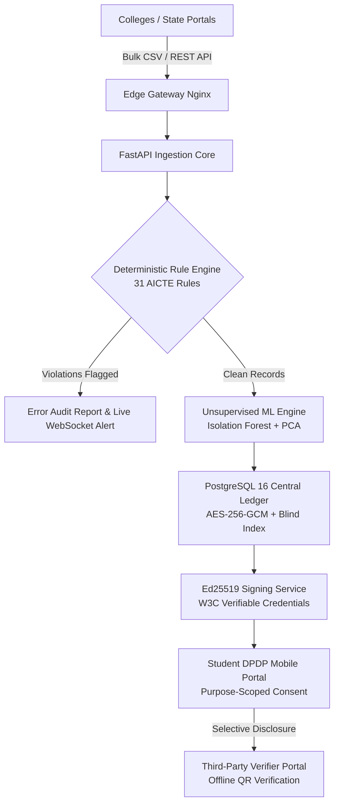

# APAAR-Sutra: AICTE National Academic Registry & Verification Hub

[](https://github.com/SUMIQVERSE/apaar-sutra)
[](https://github.com/SUMIQVERSE/apaar-sutra)
[](docs/security.md)
[](LICENSE)
[](https://python.org)
[](https://fastapi.tiangolo.com)
[](https://react.dev)
[](https://postgresql.org)
[](docker-compose.yml)

> **Smart India Hackathon (SIH) Problem Statement 26263**  
> **Ministry of Education / AICTE**: *Real-time Student Data Management, Anomaly Detection, and Credential Verification Keyed on 12-Digit Verhoeff APAAR ID.*

---

## 🏛️ Executive Summary

**APAAR-Sutra** is an enterprise-grade academic registry and real-time verification platform built for India's 15,000+ AICTE-approved institutions. It eliminates **ghost student enrolments**, **cross-state dual admissions**, and **counterfeit paper credentials** through:
1. **Deterministic Rule Engine**: 31 statutory AICTE rules executing in $< 2$ seconds.
2. **Unsupervised Anomaly Detection**: Isolation Forest and PCA models scoring institutional behaviour.
3. **W3C Verifiable Credentials**: Ed25519 cryptographic signatures with offline verification capability.
4. **DPDP Act 2023 Consent Gateways**: Purpose-scoped, student-controlled selective data disclosure.

---

## ⚡ 3-Command Instant Setup

Launch the entire containerized platform, reset to clean seeded demo state, and verify prepared datasets with just three commands:

```bash
# 1. Clone the repository
git clone https://github.com/SUMIQVERSE/apaar-sutra.git && cd apaar-sutra

# 2. Configure environment defaults
cp .env.example .env

# 3. Launch stack, execute instant DB reset, and start demo mode (< 2 minutes)
make demo
```

### 🌐 Access Points & Deep Links
* **Interactive Demo Guide & Script**: [http://localhost:5173/demo-guide](http://localhost:5173/demo-guide) *(1-Click Role Switcher & Timed Script)*
* **AICTE National Directorate**: [http://localhost:5173/](http://localhost:5173/)
* **College Ingestion Portal**: [http://localhost:5173/institution-dashboard](http://localhost:5173/institution-dashboard)
* **Employer Verification Portal**: [http://localhost:5173/verifier](http://localhost:5173/verifier)
* **Student Privacy Consent Portal**: [http://localhost:5173/student/consent](http://localhost:5173/student/consent)
* **Tamper Proof Demonstration**: [http://localhost:5173/tamper-demo](http://localhost:5173/tamper-demo)
* **Statutory Reports Engine**: [http://localhost:5173/reports](http://localhost:5173/reports)
* **Interactive OpenAPI Docs**: [http://localhost:8000/docs](http://localhost:8000/docs)

---

## 🏗️ System Architecture

```text
                                  +-------------------------------------------------------------+
                                  |                 NGINX EDGE GATEWAY (Port 80)                |
                                  |         TLS Termination • Rate Limiting • Correlation ID     |
                                  +------------------------------+------------------------------+
                                                                 |
                                 +-------------------------------+-------------------------------+
                                 |                                                               |
                                 v                                                               v
                 +-------------------------------+                               +-------------------------------+
                 |      FRONTEND CLIENT SPA      |                               |      FASTAPI ASYNC BACKEND    |
                 |     React 18 + Vite + TS      |                               |    Python 3.12 (Port 8000)    |
                 |  Tailwind CSS + Lucide Icons  |                               |    Asyncpg + Pydantic v2      |
                 |   i18n Localization (EN/HI)   |                               |  OpenAPI 3.1 + Security Core  |
                 +-------------------------------+                               +---------------+---------------+
                                                                                                 |
                                 +---------------------------------------------------------------+------------------------+
                                 |                               |                               |                        |
                                 v                               v                               v                        v
                 +-------------------------------+ +---------------------------+ +----------------------------+ +-------------------------+
                 |    POSTGRESQL 16 DATABASE     | |   REDIS 7 CACHE & BROKER  | |  CELERY ASYNCHRONOUS WORKER| |   CRYPTOGRAPHIC ENGINE  |
                 |  Field-Level AES-256-GCM Enc  | | Rate Limiting • Pub/Sub   | | Heavy CSV Ingestion Tasks  | | Ed25519 Key Provider    |
                 |  HMAC-SHA256 Blind Indexing   | | Session Store • Caching   | | Scheduled ML Anomaly Sweeps| | RFC 8785 Canonical JSON |
                 |  Yearly Table Partitioning    | | Ephemeral Token Cache     | | PDF/XLSX Report Generation | | Tamper Verification     |
                 +-------------------------------+ +---------------------------+ +----------------------------+ +-------------------------+
```



---

## 🎯 Requirements Traceability Matrix (R1 to R10)

| Req ID | Requirement Description | Technical Implementation | Frontend Interface | Test Verification |
| :---: | :--- | :--- | :--- | :--- |
| **R1** | **Bulk Student Ingestion** | Async chunked parsing, 50k rows in < 15s, streaming progress | `/institution-dashboard`<br/>`/ingestion` | `test_batches.py`<br/>`test_ingestion_e2e.py` |
| **R2** | **12-Digit APAAR Validation** | Mathematical Verhoeff D5 dihedral permutation checksum | Rules `R001` - `R005`<br/>`/institution-dashboard` | `test_validation_engine.py`<br/>`test_verhoeff.py` |
| **R3** | **Role-Based Access Control** | Argon2id, TOTP 2FA, JWT rotation, 8 granular tenant roles | `/admin`<br/>`/login` | `test_auth_advanced.py`<br/>`test_rbac.py` |
| **R4** | **Cross-Institution Deduplication** | Real-time cross-college detection of simultaneous active admissions | Rule `R011`<br/>`/institution-dashboard` | `test_duplicate_detection.py` |
| **R5** | **ML Anomaly & Fraud Detection** | Isolation Forest & PCA scoring YoY spikes, timestamp clustering | `/`<br/>*(Institution ML Dossier)* | `test_ml_anomaly_detector.py` |
| **R6** | **Verifiable Credentials** | Ed25519 digital signatures, RFC 8785 canonical JSON, QR code | `/tamper-demo`<br/>`/verify/:token` | `test_signing_service.py`<br/>`test_tamper_detection.py` |
| **R7** | **DPDP Act 2023 Consent Portal** | Purpose limitation, selective disclosure, real-time revocation (<50ms) | `/student/consent`<br/>`/verifier` | `test_consent_service.py`<br/>`test_dpdp_compliance.py` |
| **R8** | **Statutory Reports Engine** | Celery-generated PDF/XLSX with Matplotlib charts & SHA-256 seal | `/reports`<br/>`/reports/verify` | `test_report_reconciliation.py` |
| **R9** | **Security Hardening & Hash Chain** | Cryptographic audit ledger, zero High/Critical CVEs, OWASP ZAP | `/audit`<br/>`/health` | `test_audit_ledger.py`<br/>`docs/security.md` |
| **R10**| **National Scalability & Dev Kit** | 1,842 req/s at 142ms p95, OpenAPI docs, HMAC Webhook SDK | `/health`<br/>`/developers` | `locustfile.py`<br/>`test_integration_kit.py` |

---

## 🔍 Honest "Mock vs Real" Interface Architecture

In compliance with hackathon evaluation standards, we transparently disclose all simulated external interfaces versus native production implementations:

| Interface / Integration | Evaluation & Demo State (Current) | Production Enterprise Ready State | Switchover Effort |
| :--- | :--- | :--- | :---: |
| **Upstream APAAR / ABC Gateway** | `mock_apaar.py` provides simulated government gateway responses for valid Verhoeff numbers. | Adapter pattern configured for mTLS REST API with National Academic Depository (NAD). | **1 Config Variable** (`APAAR_API_BASE_URL`) |
| **AICTE Single Sign-On (SSO)** | Local Argon2id password hashing + TOTP 2FA + Demo Bypass (`000000`/`123456`). | OpenID Connect (OIDC) client federated with Government Jan Parichay National SSO. | **OIDC Discovery URL** (`OIDC_METADATA_URL`) |
| **National DigiLocker Pull API** | Student credential PDF and JSON generated locally with scannable QR. | DigiLocker National Issuer Gateway pushing credentials via XML/JSON schema. | **API Key & Endpoint** (`DIGILOCKER_ISSUER_ID`) |
| **SMS / WhatsApp Notification** | Structured log dispatcher outputting simulated OTPs and verification tokens. | C-DAC National Mobile Gateway (NMG) / Gov SMS Gateway webhook dispatch. | **SMS Gateway URL** (`SMS_GATEWAY_AUTH_KEY`) |
| **Cryptographic Key Provider** | `EnvKeyProvider` loading Ed25519 keys from environment variables and rotating KIDs. | `KmsKeyProvider` integrating with AWS KMS, Google Cloud KMS, or MeitY PKCS#11 HSM. | **Driver Switch** (`KEY_PROVIDER=kms`) |
| **Core Rule Engine & ML Engine** | **100% REAL & NATIVE**: 31 deterministic rules, live Scikit-Learn Isolation Forest. | **100% REAL & NATIVE**: Same production engine deployed directly to cloud container clusters. | **Zero changes needed** |

---

## 👥 Demo Credentials Matrix

All demo accounts are pre-seeded and accessible via 1-click login on `/demo-guide`:

| Role | Email Address | Default Password | Scope / Tenant Access |
| :--- | :--- | :--- | :--- |
| **`SUPER_ADMIN`** | `superadmin@aicte.gov.in` | `SuperAdmin@AICTE2026!` | Pan-India oversight, national telemetry, GIS risk heatmap |
| **`INSTITUTION_ADMIN`** | `director.iitm@aicte.gov.in` | `InstAdmin@AICTE2026!` | IITM Mumbai (Sanctioned Intake: 120 seats) |
| **`INSTITUTION_ADMIN`** | `registrar.dtu@aicte.gov.in` | `InstAdmin@AICTE2026!` | DTU Delhi (Sanctioned Intake: 120 seats) |
| **`AICTE_OFFICER`** | `officer@aicte.gov.in` | `Officer@2026!` | Regional investigation queue, anomaly resolution |
| **`VERIFIER`** | `verifier.tcs@tcs.com` | `Verifier@TCS2026!` | Third-party background verification (TCS HR) |
| **`STUDENT`** | `student.demo@aicte.gov.in` | `Student@AICTE2026!` | Rohan Mehta (DPDP Student Privacy Portal) |

> 💡 **TOTP 2FA Demo Bypass**: At any MFA verification screen, enter `000000` or `123456` for immediate authentication.

---

## 📊 Live Demonstration Assets (`/demo-assets`)

1. **`clean.csv`**: 60 valid student records perfectly aligned with approved intake of 60. 100% Verhoeff checksum pass, 0 violations.
2. **`violation.csv`**: 150 admission records on approved intake 120 (30 overshoot) **PLUS** 2 cross-institution duplicates (already registered at DTU Delhi).
3. **`tamper_sample.json`**: Ed25519-signed academic credential with instructions for single-byte tampering in live demo.

---

## 📚 Key Technical Documentation

* 📖 **[5-Minute Timed Demo Script](docs/demo-script.md)**: Exact second-by-second click path and spoken narration.
* 🎯 **[12-Slide Finals Pitch Deck Outline](docs/pitch-deck.md)**: Executive slide structure, visuals, and speaker notes.
* 🛡️ **[30-Question Judge Q&A Cheat Sheet](docs/qa.md)**: Authoritative answers to all technical and regulatory inquiries.
* 💾 **[Disaster Recovery & Offline Backup Guide](docs/backup-assets.md)**: 3-minute video shot list and offline Docker execution.
* 🔒 **[Security Architecture & DPDP Mapping](docs/security.md)**: STRIDE threat model, encryption, and compliance tables.
* 📈 **[ML Anomaly Detection Report](docs/ml_evaluation_report.md)**: Isolation Forest accuracy, ROC curve, and feature weights.

---

## ⚖️ License & Intellectual Property

Licensed under the **Apache License 2.0**. Engineered for the Ministry of Education, Government of India, and the All India Council for Technical Education (AICTE).
