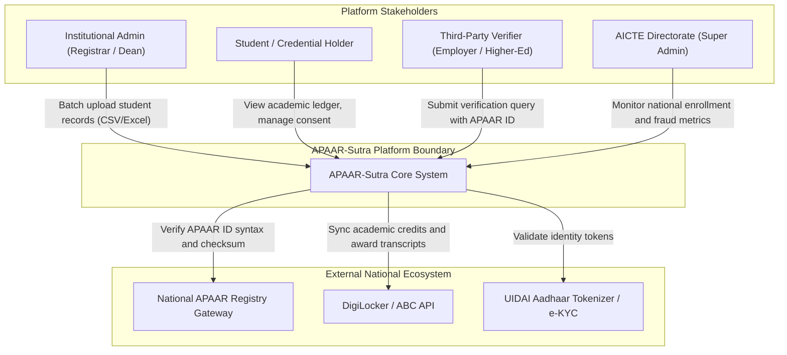
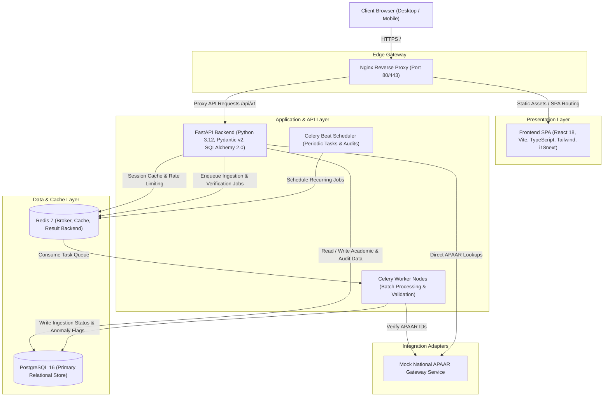
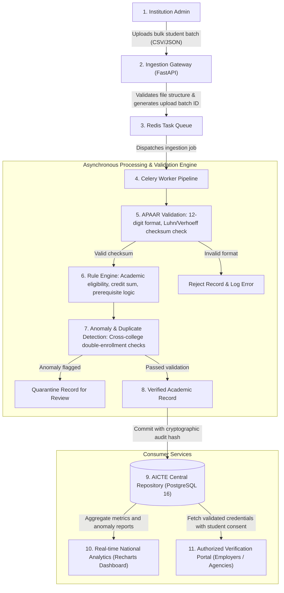

# APAAR-Sutra: Architecture Documentation

**Platform**: AICTE Student Data Management and Verification Platform  
**Problem Statement**: SIH 26263  
**Design Reference**: C4 Architecture Model & National Ingestion Pipeline  

---

## 1. System Context Diagram (C4 Level 1)

The system context diagram illustrates the external actors and systems interacting with **APAAR-Sutra**.

---

## 2. Container Diagram (C4 Level 2)

The container diagram displays the internal micro-services, databases, proxies, and background processing workers that comprise **APAAR-Sutra**.

---

## 3. Data Flow Diagram: Ingestion, Validation & Verification

This diagram depicts the end-to-end data lifecycle:  
**Institution $\rightarrow$ Upload $\rightarrow$ APAAR Validation $\rightarrow$ Rule Engine + Anomaly Detection $\rightarrow$ Verified $\rightarrow$ AICTE Central Repository $\rightarrow$ Analytics $\rightarrow$ Authorized Verification**.

---

## 4. Key Architectural Safeguards

1. **Strict Multi-Tenancy**:
   - Each database transaction initiated by an `INSTITUTION_ADMIN` enforces `institution_id = current_tenant.id` through repository-level filtering.
2. **Deterministic & Anomaly Detection Pipeline**:
   - Level 1: Deterministic syntax check (12-digit format, Luhn/Verhoeff checksum).
   - Level 2: Semantic check against mock/live government registry.
   - Level 3: Cross-college anomaly detection ensuring no student is concurrently enrolled in two full-time degree programs.
3. **Audit Trail Immutability**:
   - Write actions to records produce append-only audit entries containing before-and-after payloads, actor ID, client IP, and UTC timestamps.
