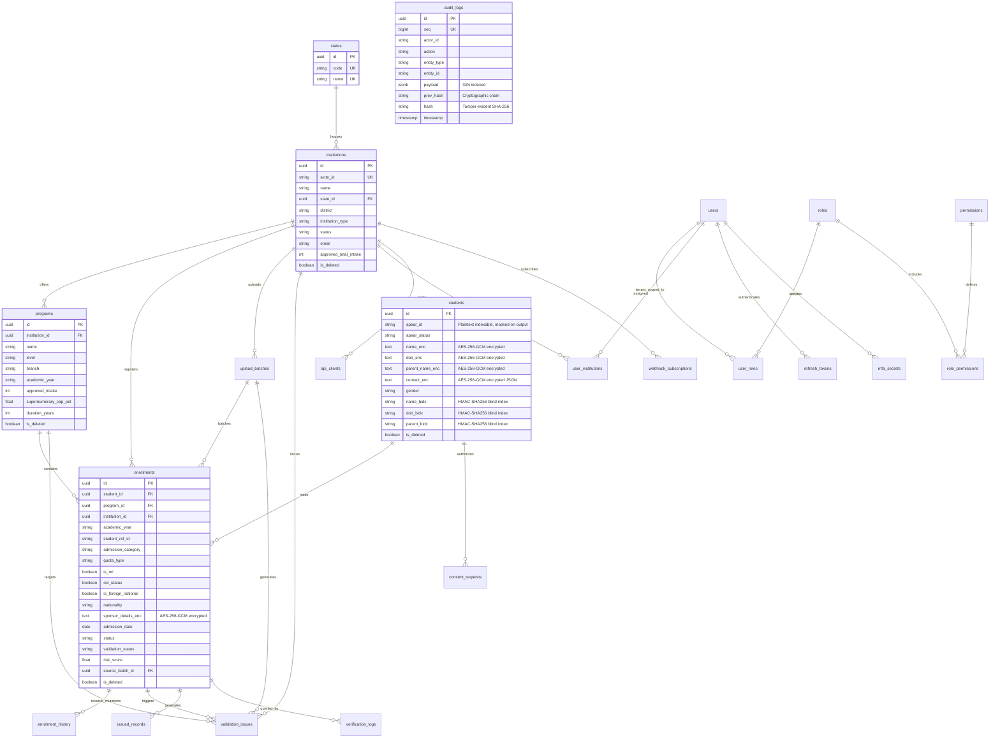

# APAAR-Sutra: Entity Relationship Diagram & Index Specification

**Platform**: AICTE Student Data Management and Verification Platform (SIH 26263)  
**Schema Revision**: Phase 1 Production Baseline  

---

## 1. Visual Entity Relationship Diagram (ERD)

---

## 2. Rationale for Constraints & Indexes

### A. Primary Key and Foreign Key Strategy
- **UUIDv4 Primary Keys**: Every entity uses a cryptographically random UUIDv4 (`as_uuid=True`), preventing sequential enumeration attacks and cross-tenant leakage.
- **Cascading Deletions**:
  - Dependent entities (`programs`, `enrolments`, `user_roles`) specify `ondelete="CASCADE"` when their parent record is deleted.
  - Foreign keys to historical references (e.g. `upload_batches.uploaded_by`, `validation_issues.resolved_by`) specify `ondelete="SET NULL"` to preserve auditability even after an administrative user account is removed.

### B. Unique Constraints vs. Anomaly Detection Strategy
- **`uq_programs_inst_name_branch_ay` on `(institution_id, name, branch, academic_year)`**:
  Guarantees that a single institution cannot define overlapping duplicate programs for the same cohort.
- **`uq_enrolments_student_inst_prog_ay` on `(student_id, institution_id, program_id, academic_year)`**:
  Guarantees that a student cannot be doubly enrolled in the *same* program within the *same* institution.
- **CRITICAL DESIGN RATIONALE: Cross-Institution Active Enrolments**:
  A global unique constraint on `(student_id, academic_year)` is **deliberately avoided**. In the real world, students illegally or mistakenly register for two full-time degrees across different universities. The platform's mission is to **ingest, identify, flag, and quarantine** fraudulent duplicate enrolments through the rule engine rather than throwing a raw database integrity error that drops the record from tracking!

### C. Check Constraints
- **`ck_students_apaar_id_format`**:
  `CHECK (apaar_id ~ '^[0-9]{12}$' OR apaar_id IS NULL)`
  Enforces that if an APAAR ID is present, it must strictly be 12 numeric digits. Missing or pending APAAR IDs are stored as `NULL` and flagged with status `UNVERIFIED` or `PENDING`.

### D. Composite & Performance Indexes
| Index Name | Table | Columns | Type / Method | Operational Rationale |
| :--- | :--- | :--- | :--- | :--- |
| `ix_enrolments_inst_ay` | `enrolments` | `(institution_id, academic_year)` | B-Tree | High-throughput college intake reconciliation and semester quota verification. |
| `ix_enrolments_student_id` | `enrolments` | `(student_id)` | B-Tree | Rapid retrieval of student academic history across institutions. |
| `ix_enrolments_ay_status` | `enrolments` | `(academic_year, status)` | B-Tree | National-level queries aggregating active student counts for a given academic year. |
| `ix_students_apaar_id` | `students` | `(apaar_id)` | B-Tree | Instant primary lookup by 12-digit APAAR ID from the verification portal and external gateways. |
| `ix_students_name_bidx` | `students` | `(name_bidx)` | B-Tree | Exact-match equality search on encrypted student names without decryption. |
| `ix_students_dob_bidx` | `students` | `(dob_bidx)` | B-Tree | Exact-match equality search on encrypted student dates of birth. |
| `ix_audit_logs_payload_gin` | `audit_logs` | `(payload)` | GIN | High-speed JSONB sub-key querying for forensic auditing and compliance investigations. |
| `ix_validation_rules_params_gin` | `validation_rules` | `(params)` | GIN | Enables dynamic parameter matching inside rule evaluation pipelines. |
| `ix_validation_issues_explanation_gin` | `validation_issues` | `(explanation)` | GIN | Filters and aggregates anomaly classifications across millions of validation issues. |
| `ix_audit_logs_seq` | `audit_logs` | `(seq)` | B-Tree Unique | Strict monotonic sequencing for tamper-evident cryptographic hash verification. |
