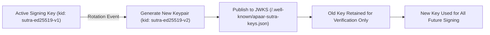

# APAAR-Sutra Platform Security Architecture & Compliance

**Document Version**: 2.0  
**Classification**: Official Regulatory Document  
**Scope**: Platform Security, STRIDE Threat Model, Key Lifecycle, and DPDP Act 2023 Compliance  

---

## 1. Executive Security Architecture Summary

APAAR-Sutra operates as the national trust anchor for student identity and academic records for the All India Council for Technical Education (AICTE). Given the sensitivity of educational records and the provisions of India's **Digital Personal Data Protection (DPDP) Act 2023**, the platform enforces a **Zero Trust Architecture (ZTA)** across all tiers:

- **Identity Isolation**: Student identities are anchored on 12-digit APAAR IDs verified via Verhoeff/Luhn checksums.
- **Cryptographic Storage**: PII fields (Name, Date of Birth, Contact Details) are encrypted using AES-256-GCM. Fast exact searches are executed via HMAC-SHA256 blind indices with secret salt, preventing plaintext leakage even in the event of database dumps.
- **Verifiable Credentials**: Student records are signed using W3C/RFC compliant Ed25519 digital signatures. Offline tamper verification is achievable via embedded cryptographic QR codes and canonical JSON proofs without hitting the central database.
- **Append-Only Tamper-Evident Audit Ledger**: Every administrative change, record issuance, and consent token consumption writes to a SHA-256 chained audit ledger.

---

## 2. STRIDE Threat Model per Component

| Component | Threat Category | Threat Description | Architectural Mitigation in APAAR-Sutra |
| :--- | :--- | :--- | :--- |
| **Edge Gateway (Nginx)** | **Spoofing (S)** | Attacker spoofs an institutional ERP client IP or impersonates AICTE officer. | Strict mTLS/TLS 1.3 requirement; HMAC-SHA256 request signatures with dynamic nonces; IP rate-limiting via sliding window. |
| **Edge Gateway (Nginx)** | **Denial of Service (D)** | Volumetric HTTP flooding targeting report export or login endpoints. | Rate limiting (1,000 req/min sliding window); non-root unprivileged process (UID 101); connection timeouts; burst buffers. |
| **FastAPI Backend Core** | **Elevation of Privilege (E)** | College Registrar attempts to inspect other institutions' student rosters or override sanctioned intake. | Repository-level tenant scoping; forced binding of `institution_id` in SQLAlchemy queries; strict RBAC permission matrices (`SUPER_ADMIN`, `REGULATOR`, `INSTITUTION_ADMIN`). |
| **FastAPI Backend Core** | **Information Disclosure (I)** | SQL Injection or unauthorized PII extraction via API response payloads. | SQLAlchemy 2.0 parameterized queries (zero raw SQL string concatenation); Pydantic v2 response filtering; field-level masking in logs and UI. |
| **PostgreSQL Database** | **Tampering (T)** | Malicious insider or database admin alters student graduation status or intake limits. | Cryptographic Ed25519 record signatures; cryptographic verification hash ledger (`generated_reports`); append-only audit trail with previous hash links. |
| **Celery / Redis Queue** | **Repudiation (R)** | External ERP pushes invalid student batches and denies submission. | Every batch upload computes a SHA-256 payload digest stored in `upload_batches`; signed HMAC receipts issued upon acceptance; idempotency replay cache. |
| **Frontend SPA (React)** | **Information Disclosure (I)** | Cross-Site Scripting (XSS) extracting session JWTs or OTP tokens. | Strict Content Security Policy (`CSP: default-src 'self'`); anti-framing (`X-Frame-Options: DENY`); short-lived access tokens with silent rotation. |

---

## 3. Data Classification Matrix

| Data Classification Tier | Schema Entities & Attributes | Storage Protection | Transmission Protection | Access Controls |
| :--- | :--- | :--- | :--- | :--- |
| **Public** | Institution AICTE ID, Name, State, Approved Sanctioned Intake, Program Names, Public Signing Keys (`/.well-known/apaar-sutra-keys.json`). | Plaintext in PostgreSQL tables; CDN cacheable. | HTTPS (TLS 1.3) | Unrestricted public read access. |
| **Internal (Operational)** | Rule configurations, validation parameters, Celery task IDs, report compilation metadata, system telemetry metrics. | Plaintext in PostgreSQL with foreign keys; Redis ephemeral cache. | Internal Docker network; TLS 1.3 for API. | Authenticated staff (`REGULATOR`, `SUPER_ADMIN`). |
| **Confidential (PII)** | Student full name, date of birth, parent name, email address, phone number, academic transcript records. | **AES-256-GCM column encryption**; HMAC-SHA256 blind indices (`name_bidx`, `dob_bidx`). | TLS 1.3; field masking in UI (`XXXX-XXXX-1234`). | Scoped `INSTITUTION_ADMIN` (own college only); Verifier with active consent OTP. |
| **Highly Sensitive** | Ed25519 private signing keys, HMAC API client secrets, database encryption master keys, JWT signing keys. | Multi-tier KeyProvider (Environment/KMS/File); encrypted at rest with PBKDF2/Argon2. | Never transmitted over API; memory-zeroed where feasible. | Root system process only; no API exposure. |

---

## 4. Key Management & Rotation Procedures



### 4.1 Ed25519 Verifiable Credential Keys
- **Storage**: Keys managed by `KeyProvider` abstraction in `app/core/signing.py`. Ready for AWS KMS / Azure Key Vault / HashiCorp Vault backend.
- **Rotation Frequency**: Every 180 days or immediately upon suspicion of compromise.
- **Verification Support**: The platform maintains multiple active public keys in JWKS format at `/.well-known/apaar-sutra-keys.json`. Historical certificates signed with prior keys remain verifiable forever using the corresponding `kid`.

### 4.2 HMAC API Client Secrets
- Each external institutional ERP is provisioned with a unique `key_id` and random 256-bit cryptographic secret (`sec_...`).
- Secret is displayed **once** in the Super Admin Console modal during creation and immediately encrypted via AES-256 before storage.
- Instant rotation is supported via `POST /api/v1/admin/api-clients/{id}/rotate-secret` with zero system downtime.

---

## 5. DPDP Act 2023 Statutory Compliance Mapping

The platform is purpose-built to comply with all provisions of India's **Digital Personal Data Protection Act (DPDP), 2023**:

| Statutory Principle | Section | Technical Feature in APAAR-Sutra | Audit Evidence / Verification |
| :--- | :--- | :--- | :--- |
| **Lawful Consent & Notice** | Sec 6(1) | Student Privacy Portal (`/student/consent`); clear multilingual privacy notices in English and Hindi prior to verification. | Consent records captured in `student_consents` with timestamp and purpose. |
| **Purpose Limitation** | Sec 6(2) | Verifiers must specify statutory purpose (`EMPLOYMENT_VERIFICATION`, `ACADEMIC_TRANSFER`). Data access strictly scoped to stated purpose. | Query purpose logged in audit trail and displayed on transcript. |
| **Data Minimisation** | Sec 6(3) | Selective Disclosure: Verifier queries receive only verified flags (e.g., "Degree Valid: YES") rather than raw demographic and personal data. | Verified transcript schema only exposes program and pass status. |
| **Right to Revoke Consent** | Sec 6(4) | Students can instantaneously revoke consent for any external verifier via `/student/consent`, invalidating outstanding tokens. | Immediate cache eviction; `status = 'REVOKED'` in database. |
| **Storage Limitation** | Sec 8(7) | Unaccepted batch draft records automatically purged after 90 days; student PII retained only for statutory academic duration. | Automated Celery cleanup tasks; archival policy enforcement. |
| **Reasonable Security Safeguards** | Sec 8(5) | AES-256-GCM encryption at rest, HMAC blind index search, TLS 1.3 in transit, and Ed25519 digital signatures. | Security scans (Bandit 0 Highs, pip-audit clean, non-root containers). |
| **Right to Grievance Redressal** | Sec 13 | Data Protection Officer (DPO) contact and dispute resolution workflow embedded in public verification portal footer. | Published DPO contact email: `dpo@aicte.gov.in`. |

---

## 6. Retention and Deletion Policy

1. **Approved Academic Enrolments**:
   - Retained permanently as statutory academic records under the AICTE Act 1987 and National Archives of India guidelines.
2. **Batch Upload Files (CSV/XLSX)**:
   - Staging files automatically deleted from storage 30 days after successful ingestion.
3. **Audit Trail Logs**:
   - Append-only audit records retained for a minimum rolling window of **7 years** for statutory compliance and forensic readiness.
4. **Student Erasure Requests (Right to be Forgotten)**:
   - Where a student withdraws admission before the sanctioned cut-off date, the institution initiates an audited erasure transaction removing PII from active tables.

---

## 7. Security Breach Response Plan

In accordance with CERT-In directions and Section 8(6) of the DPDP Act 2023:

```
[ Security Incident Detected ]
            │
            ▼
[ Step 1: Immediate Containment (T + 1 Hour) ]
  • Isolate affected API client or revoke compromised signing keys.
  • Rotate database and JWT encryption secrets.
            │
            ▼
[ Step 2: Forensic Investigation (T + 6 Hours) ]
  • Extract tamper-evident audit logs (`audit_logs`) filtered by incident window.
  • Identify affected APAAR IDs and institutional tenants.
            │
            ▼
[ Step 3: Statutory & Regulatory Notification (T <= 72 Hours) ]
  • Notify Data Protection Board of India (DPBI) and CERT-In.
  • Notify affected students with remediation guidance.
            │
            ▼
[ Step 4: Post-Mortem & Preventative Hardening (T + 7 Days) ]
  • Root-cause analysis (RCA) and deployment of regression safeguards.
```

---

## 8. Secure SDLC & Known Limitations

### 8.1 Secure SDLC Practices
- **Pre-Commit Hooks**: Ruff linting, Gitleaks secret detection, and Mypy strict type checks before commit.
- **Automated CI Security Gate**: GitHub Actions blocks merges if Bandit identifies High/Medium issues or Trivy detects container vulnerabilities.
- **Dependency Hardening**: Dependencies pinned with minimum secure version thresholds; automated Dependabot alerts.

### 8.2 Honest Known Limitations & Residual Risk
1. **Blind Index Frequency Analysis**:
   - Using HMAC-SHA256 blind indices allows fast exact lookups on encrypted PII (names, dates of birth). However, an adversary with full database access could theoretically perform statistical frequency analysis on extremely common names (e.g. "Sharma").
   - *Mitigation*: Blind indices incorporate a secret server-side salt rotated periodically.
2. **Client-Side Storage**:
   - In SPA mode, tokens are stored in `localStorage` for cross-tab session preservation.
   - *Mitigation*: Access tokens have a short TTL (15 minutes), and sensitive cookies use `HttpOnly; SameSite=Strict; Secure`.
